<div align="center">

<a href="https://www.xijiawei.com">
  
</a>

<a href="https://www.xijiawei.com"></a>
<a href="https://scholar.google.com/citations?hl=en&user=C1p76VgAAAAJ"></a>
<a href="https://orcid.org/0000-0003-4745-6569"></a>
<a href="mailto:weixijia@outlook.com"></a>

</div>

### `$ whoami`

```python
class XijiaWei(Researcher):
    """Machine learning for novel sensing systems in healthcare."""

    alias       = "Simon"
    position    = "PhD candidate (writing up), University College London"
    supervisors = ["Nadia Bianchi-Berthouze", "Youngjun Cho", "Kevin Chetty"]
    experience  = {
        2025: "HFC GenAI Fellow @ Scale AI          # domain-specific LLM post-training",
        2023: "Research Scientist Intern @ Nokia Bell Labs  # earable acoustic sensing",
        2022: "Research Assistant @ UCL Interaction Centre  # UKRI / EU projects",
    }
    education   = ["MSc Artificial Intelligence, Edinburgh",
                   "BEng Electronics & Electrical Engineering, Edinburgh"]

    modalities  = ["mmWave radar", "WiFi CSI", "IMU", "earable acoustics", "RGB-D", "skeleton"]
    methods     = ["self-supervised pre-training", "multimodal fusion",
                   "transfer learning", "cross-domain generalisation"]
    service     = {"AC": ["AAAI 2025", "CHI 2024", "IMWUT 2023"], "PC": ["ACII 2023"]}

    def research(self, signals):
        # learn transferable features from multisensory data, without label-hungry annotation
        return self.understand_human_behaviour(self.pretrain(signals), in_the_wild=True)
```

### `$ tree ./research`

```mermaid
flowchart LR
    subgraph SENSE["Sensing"]
        direction TB
        s1["mmWave radar<br/>range–Doppler cubes"]
        s2["WiFi CSI"]
        s3["Smartphone inertial<br/>multisensor"]
        s4["Earable acoustics"]
        s5["RGB-D · skeleton"]
    end

    subgraph CAP["Capture"]
        v["Vomee<br/>time-synchronised<br/>multimodal platform"]
    end

    subgraph LEARN["Learning"]
        direction TB
        l1["Self-supervised<br/>pre-training"]
        l2["Multimodal fusion<br/>& attention"]
        l3["Transfer learning<br/>& domain adaptation"]
    end

    subgraph APP["Applications"]
        direction TB
        a1["Indoor localisation"]
        a2["Pain & protective<br/>behaviour recognition"]
        a3["Cognitive load<br/>monitoring"]
        a4["Pose · gesture · activity"]
        a5["3D drone detection"]
    end

    SENSE --> CAP --> LEARN --> APP
```



### `$ cat selected_publications.bib`

| Year | Venue | Paper |
|:----:|:-----:|:------|
| 2025 |  | [**Listening to the Mind: Earable Acoustic Sensing of Cognitive Load**](https://doi.org/10.1145/3714394.3756157) |
| 2025 |  | [CubeDN: Real-Time Drone Detection in 3D Space from Dual mmWave Radar Cubes](https://www.xijiawei.com/publications/#2025-cubedn) |
| 2025 |  | [Cognitive Load Monitoring via Earable Acoustic Sensing](https://www.xijiawei.com/publications/#2025-cognitive-load) |
| 2025 |  | [**WiProt: A WiFi-RGBD Fusion System for Robust Protective Behaviour Recognition**](https://www.xijiawei.com/publications/#2025-wiprot) |
| 2025 |  | [**Vomee: A Multimodal Sensing Platform for Video, Audio, mmWave and Skeleton Data Capturing**](https://www.xijiawei.com/publications/#2025-vomee) |
| 2025 |  | [**mmWaveTryOn: The First mmWave-RGB Dataset for Clothes Try-On Multimodal Gesture Recognition**](https://www.xijiawei.com/publications/#2025-mmwavetryon) |
| 2023 |  | [**Leveraging WiFi Sensing Toward Automatic Recognition of Pain Behaviors**](https://www.xijiawei.com/publications/#2023-wifi-pain) |
| 2021 |  | [**Sensor-Fusion for Smartphone Location Tracking Using Hybrid Multimodal Deep Neural Networks**](https://www.mdpi.com/1424-8220/21/22/7488) |
| 2021 |  | [**MM-Loc: Cross-Sensor Indoor Smartphone Location Tracking Using Multimodal Deep Neural Networks**](https://ieeexplore.ieee.org/document/9662519/) |
| 2019 |  | [**Calibrating Recurrent Neural Networks on Smartphone Inertial Sensors for Location Tracking**](https://www.xijiawei.com/files/ipin2019.pdf) |

<sub>**Bold** = first author ·  conference ·  workshop ·  journal · full list → [xijiawei.com/publications](https://www.xijiawei.com/publications/)</sub>

### `$ tail -n 4 news.log`

```diff
+ 2026-02  Earable cognitive-load sensing featured by Scimex & Univ. of Melbourne Ingenium
+ 2025-11  Invited talk @ University of Macau: multimodal self-supervised learning for healthcare
+ 2025-10  Presented 4 works @ MobiCom 2025: wireless sensing, behaviour recognition, open-source multimodal platform
+ 2025-10  Presented earable acoustic sensing for auditory cognitive load @ UbiComp 2025 (w/ Nokia Bell Labs)
```

### `$ pip list --research-stack`

<p>
  
</p>

<p>
  
  
  
  
  
  
</p>

### `$ git log --graph --all`

<picture>
  <source media="(prefers-color-scheme: dark)" srcset="https://raw.githubusercontent.com/weixijia/weixijia/output/github-snake-dark.svg" />
  <source media="(prefers-color-scheme: light)" srcset="https://raw.githubusercontent.com/weixijia/weixijia/output/github-snake.svg" />
  
</picture>

<picture>
  <source media="(prefers-color-scheme: dark)" srcset="https://streak-stats.demolab.com?user=weixijia&theme=github-dark-blue&hide_border=true&background=0D111700" />
  <source media="(prefers-color-scheme: light)" srcset="https://streak-stats.demolab.com?user=weixijia&theme=default&hide_border=true&background=FFFFFF00" />
  
</picture>

<sub>Most research code lives in private repos until the corresponding paper is out.</sub>
